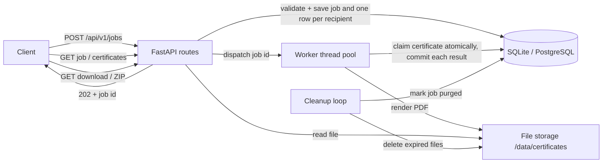

# Bulk Certificate Generator API

A FastAPI backend that turns **one request with many recipients** into PDF certificates. It
validates every recipient, generates the certificates in the background, tracks progress,
survives restarts, and lets clients download certificates one by one or as a ZIP.

## 1. Problem statement

After an event or course, an organization needs certificates for hundreds or thousands of
participants. One API call per certificate is slow and error-prone, and a single bad row
(missing name, unprintable character) must not ruin the whole batch. This service accepts the
whole list at once, answers immediately with a job id, and reports per-recipient results.

## 2. Features

- **Bulk jobs**: up to `MAX_RECIPIENTS` (default 5000) recipients per request; `202 Accepted` with a job id immediately.
- **Per-recipient validation**: name, email format, remarks, control characters, duplicates. Bad recipients are marked `INVALID` with the reason; the rest are still generated.
- **Failure isolation**: each certificate is generated and committed on its own; one failure never stops the job (`COMPLETED_WITH_ERRORS`).
- **Progress tracking**: live `progress %`, counts of completed / failed / invalid / pending.
- **Retry**: `POST /jobs/{id}/retry` re-queues only `FAILED` certificates (capped by `MAX_ATTEMPTS`); finished certificates are never regenerated.
- **Idempotent submission**: `Idempotency-Key` header makes client retries safe (no duplicate jobs).
- **Restart safety**: interrupted jobs resume automatically at startup, without redoing finished work.
- **Two PDF templates** (`classic`, `modern`) with organization name, signatory name/title, date, remarks and a unique certificate number.
- **Downloads**: single PDF or one ZIP per job.
- **Retention**: files are deleted `RETENTION_DAYS` after a job finishes (history is kept); temp files are cleaned up.
- **Security basics**: optional API key, CORS allow-list, request-size and batch-size limits, path-traversal-safe storage, no internal details in errors, structured logs.
- **Quality**: 76 tests (run on SQLite and PostgreSQL), ruff, mypy, Dockerfile + Compose, GitHub Actions CI.

## 3. Architecture and request flow



1. **Submit**: the API validates the request, stores a `jobs` row and one `certificates` row per
   recipient (`PENDING`, or `INVALID` with the reason), and returns `202` immediately.
2. **Process**: a worker thread takes the job. For each `PENDING` certificate it (a) *claims* it
   with an atomic `UPDATE ... WHERE status='PENDING'`, (b) renders the PDF to a temp file and
   renames it into place, (c) commits `COMPLETED` or `FAILED` (+ safe error message).
3. **Finish**: when nothing is left, the job becomes `COMPLETED`, `COMPLETED_WITH_ERRORS` or
   `FAILED`; final counts and the expiry date are stored.
4. **Track and download**: the client polls the job, lists certificates (filter by status), and downloads.
5. **Expire**: a periodic cleanup deletes the files of expired jobs and marks the job `purged_at`.

Because *all state is in the database*, a crash loses nothing: on startup, `PENDING`/`PROCESSING`
jobs are re-queued and only unfinished certificates are processed.

## 4. Technology stack, and why

| Technology | Why |
|---|---|
| **FastAPI** | Typed request/response models, automatic Swagger UI, easy dependency injection |
| **Pydantic** | Validation of requests (and per-recipient rules) with clear error messages |
| **SQLAlchemy 2** | One ORM for SQLite (local) and PostgreSQL (production) |
| **SQLite / PostgreSQL** | SQLite = zero setup; PostgreSQL = production database (`DATABASE_URL`) |
| **ReportLab** | Pure-Python PDF drawing, fast (roughly 150-200 certificates/second in my tests) and no system dependencies |
| **ThreadPoolExecutor** | Background processing without extra infrastructure (see section 14 for why not Celery) |
| **pytest** | Unit + API tests with temporary databases and folders |
| **Docker / Compose** | Reproducible run with PostgreSQL |
| **GitHub Actions** | Lint, type-check and tests on every push and pull request |

## 5. Project structure

```
app/
  main.py                 app factory, error handlers, middleware, startup (recovery, cleanup loop)
  config.py               all settings from environment variables
  database.py             engine, sessions, SQLite/PostgreSQL setup
  models.py               Job and Certificate tables + status constants
  schemas.py              Pydantic request/response models
  errors.py               AppError classes + the one JSON error format
  security.py             API-key dependency, request-size middleware
  storage.py              storage keys -> safe file paths (path-traversal guard)
  logging_config.py       text / JSON structured logging
  api/jobs.py             job endpoints (create, status, list, retry, ZIP)
  api/certificates.py     certificate endpoints (details, PDF download)
  services/jobs.py        validation, idempotency, status, finalize, retry
  services/processor.py   worker pool, per-certificate isolation, crash recovery
  services/pdf.py         the two certificate templates
  services/cleanup.py     retention and temp-file cleanup
tests/                    76 tests
examples/                 request.json, demo_client.py
Dockerfile  docker-compose.yml  .env.example  pyproject.toml  .github/workflows/ci.yml
```

## 6. Prerequisites and installation

Python **3.11+**. (Docker optional.)

**Windows (PowerShell):**
```powershell
cd bulk-certificate-api
py -3.12 -m venv .venv
.venv\Scripts\Activate.ps1          # if blocked: Set-ExecutionPolicy -Scope Process Bypass
pip install -r requirements-dev.txt
```
**Linux / macOS:**
```bash
python3 -m venv .venv && source .venv/bin/activate
pip install -r requirements-dev.txt
```

## 7. Configuration (environment variables)

Copy `.env.example` to `.env` for Docker Compose. The app itself reads real environment variables.
Nothing secret is stored in the repository; `.env` is git-ignored.

| Variable | Default | Meaning |
|---|---|---|
| `DATABASE_URL` | `sqlite:///data/certificates.db` | `postgresql://user:pw@host:5432/db` for PostgreSQL |
| `DATA_DIR` | `data` | base folder; certificates in `DATA_DIR/certificates`, temp ZIPs in `DATA_DIR/tmp` |
| `API_KEY` | *(unset)* | if set, every `/api/v1/*` call needs header `X-API-Key` |
| `CORS_ORIGINS` | *(unset = CORS off)* | comma-separated allowed origins |
| `MAX_RECIPIENTS` | `5000` | recipients per request (returns `413`) |
| `MAX_REQUEST_BYTES` | `5242880` | request body limit (returns `413`) |
| `MAX_ATTEMPTS` | `3` | generation attempts per certificate (first run + retries) |
| `WORKERS` | `2` | jobs processed concurrently |
| `RETENTION_DAYS` | `7` | files deleted this long after a job finishes |
| `CLEANUP_INTERVAL_MINUTES` | `60` | `0` disables the periodic cleanup |
| `DEFAULT_ISSUER` / `DEFAULT_SIGNATORY_NAME` / `DEFAULT_SIGNATORY_TITLE` | see `.env.example` | used when the request omits them |
| `CERT_FONT_PATH` | *(unset)* | TTF font for characters outside Latin-1 |
| `LOG_LEVEL` / `LOG_FORMAT` | `INFO` / `text` | `LOG_FORMAT=json` for log aggregation |
| `INLINE_PROCESSING` | `false` | `true` generates inside the request (used by tests) |

## 8. Run locally, with Docker, and the tests

```powershell
# Local (SQLite)
uvicorn app.main:app --reload            # http://localhost:8000/docs  (Swagger UI)

# Tests / quality checks
pytest                                    # 76 tests, about 3 s, temp DB + temp folders
ruff check . ; ruff format --check . ; mypy

# Tests against PostgreSQL
$env:TEST_DATABASE_URL="postgresql://user:pw@localhost:5432/certs_test"; pytest

# Docker (API + PostgreSQL)
copy .env.example .env                    # then edit POSTGRES_PASSWORD (and optionally API_KEY)
docker compose up --build -d
docker compose logs -f api
docker compose ps                         # both services should become "healthy"
docker compose down                       # stop (keeps data)   |   docker compose down -v  (deletes data)

# Run the retention cleanup by hand (it also runs automatically)
python -m app.services.cleanup
```
(Linux/macOS: replace `copy` with `cp`, and `$env:X="..."` with `X=... pytest`.)

## 9. API

Interactive docs: **`/docs`** (Swagger UI) and `/redoc`. If `API_KEY` is set, send `X-API-Key: <key>`.

| Method | Path | Purpose | Success |
|---|---|---|---|
| POST | `/api/v1/jobs` | Create a bulk job (optional `Idempotency-Key` header) | `202` (`200` on idempotent replay) |
| GET | `/api/v1/jobs/{job_id}` | Status and progress | `200` |
| GET | `/api/v1/jobs/{job_id}/certificates?status=&limit=&offset=` | Per-recipient results (paginated) | `200` |
| POST | `/api/v1/jobs/{job_id}/retry` | Re-queue `FAILED` certificates | `202` |
| GET | `/api/v1/jobs/{job_id}/download` | ZIP of all generated certificates | `200` |
| GET | `/api/v1/certificates/{id}` | One certificate's details | `200` |
| GET | `/api/v1/certificates/{id}/download` | One PDF | `200` |
| GET | `/health` | Liveness + database check (`503` if the DB is down) | `200` |

### Create a job

`title` is required. Optional: `issued_by`, `issue_date`, `template` (`classic` or `modern`),
`signatory_name`, `signatory_title`. Each recipient: `name` (required, max 100 chars), `email`
(optional, validated), `remarks` (optional, printed under the course title).

```bash
curl -X POST http://localhost:8000/api/v1/jobs \
  -H "Content-Type: application/json" -H "Idempotency-Key: bootcamp-2026-batch-1" \
  -d @examples/request.json
```
(Windows: use `curl.exe`; add `-H "X-API-Key: ..."` if a key is configured.)
```json
{
  "id": "a0e9da8cbf9a4a9899566a88ce0a5b64", "title": "Data Science Bootcamp",
  "issued_by": "Aereo Academy", "issue_date": "2026-10-01", "template": "classic",
  "signatory_name": "Dr. Priya Nair", "signatory_title": "Program Director",
  "status": "PENDING", "total": 3, "completed": 0, "failed": 0, "invalid": 1, "pending": 2,
  "progress": 33.3, "files_available": false,
  "created_at": "2026-10-10T11:05:20.416697Z", "finished_at": null, "expires_at": null
}
```
Sending the same `Idempotency-Key` with the same body again returns the **same job** (`200`, header
`Idempotent-Replayed: true`). The same key with a *different* body returns `409`.

### Status values

| Job | Meaning |
|---|---|
| `PENDING` then `PROCESSING` | queued, then running |
| `COMPLETED` | every certificate generated |
| `COMPLETED_WITH_ERRORS` | partially completed: some `FAILED`/`INVALID` |
| `FAILED` | nothing could be generated |

| Certificate | Meaning |
|---|---|
| `PENDING` / `PROCESSING` | waiting / being rendered |
| `COMPLETED` | PDF ready (`download_url` present) |
| `FAILED` | valid data but generation failed; **retryable** |
| `INVALID` | rejected by validation; never attempted. **Fix the data and submit it again** |

### Check progress, find problems, download

```bash
curl http://localhost:8000/api/v1/jobs/{job_id}
# {"status": "COMPLETED_WITH_ERRORS", "total": 3, "completed": 2, "failed": 0, "invalid": 1,
#  "pending": 0, "progress": 100.0, "files_available": true, "expires_at": "2026-10-17T11:05:21Z", ...}

curl "http://localhost:8000/api/v1/jobs/{job_id}/certificates?status=INVALID"
# {"job_id": "...", "total": 1, "limit": 100, "offset": 0, "results": [
#   {"id": "...", "index": 2, "status": "INVALID", "attempts": 0, "recipient_name": null,
#    "error": "name: String should have at least 1 character", "download_url": null, ...}]}

curl -OJ http://localhost:8000/api/v1/certificates/{certificate_id}/download   # one PDF
curl -OJ http://localhost:8000/api/v1/jobs/{job_id}/download                   # ZIP: 00001_Asha_Rao.pdf, ...
curl -X POST http://localhost:8000/api/v1/jobs/{job_id}/retry                  # {"job_id": "...", "requeued": 1, "status": "PENDING"}
```
A complete example in Python (standard library only): `python examples/demo_client.py`.

### Errors (one format everywhere)

```json
{"error": {"code": "validation_error", "message": "Invalid request",
           "details": [{"field": "recipients", "message": "List should have at least 1 item after validation, not 0"}]}}
```

| Status | `code` | When |
|---|---|---|
| 401 | `unauthorized` | API key required and missing/wrong |
| 404 | `not_found` | unknown job / certificate / route |
| 409 | `conflict` | nothing to download or retry; job still running; idempotency key reused with another body |
| 410 | `gone` | files were deleted after the retention period |
| 413 | `payload_too_large` | more than `MAX_RECIPIENTS` recipients or body larger than `MAX_REQUEST_BYTES` |
| 422 | `validation_error` | malformed or invalid request |
| 500 | `internal_error` | unexpected error: generic message, details only in the server log |

## 10. Example workflow

1. `POST /api/v1/jobs` with the recipients: you get `202`; save the `id`.
2. Poll `GET /api/v1/jobs/{id}` until `status` is `COMPLETED`, `COMPLETED_WITH_ERRORS` or `FAILED`.
3. If `invalid > 0`: `GET .../certificates?status=INVALID`, correct those rows and submit them as a new job.
   If `failed > 0`: `POST .../retry`.
4. `GET .../download` for the ZIP, or use each certificate's `download_url`.
5. Download within `RETENTION_DAYS` (the job response shows `expires_at`); afterwards you get `410`.

## 11. Database schema

**`jobs`**: one row per request.
`id` (PK), `title`, `issued_by`, `issue_date`, `template`, `signatory_name`, `signatory_title`,
`status` (indexed), `total`, `succeeded_count`, `failed_count`, `invalid_count` (final tallies),
`idempotency_key` (**unique**), `request_hash`, `created_at`, `finished_at`, `expires_at` (indexed), `purged_at`.

**`certificates`**: one row per recipient.
`id` (PK, random 32-hex, unguessable), `job_id` (FK to jobs, `ON DELETE CASCADE`), `seq` (position in the request),
`status`, `attempts`, `recipient_name`, `email`, `remarks`, `payload` (original JSON),
`certificate_number` (**unique**, e.g. `CERT-A0E9DA8C-00001`), `storage_key` (file reference, never the file),
`error`, `created_at`, `completed_at`.
Constraints and indexes: unique `(job_id, seq)`; index `(job_id, status)` (progress counts and filters); index on `job_id`.

PDFs are never stored in the database, only the `storage_key` (`<job_id>/<certificate_id>.pdf`).
Tables are created at startup (`create_all`). There are no migrations yet (see section 14).

## 12. Testing

```bash
pytest                      # all 76 tests
pytest tests/test_retry_and_idempotency.py -v
pytest --cov=app            # coverage (needs: pip install pytest-cov); 96% when last measured
```
Tests use a temporary database and temporary folders, so they never touch real data. They cover:
creation, validation (malformed, empty, oversized, per-recipient), PDF content, both templates,
progress, partial failures, error hygiene, retry and attempt limits, idempotency, ZIP/PDF downloads,
interrupted jobs and the poison-certificate guard, concurrent workers, retention/cleanup,
API key, CORS, path traversal, error format, health, and schema constraints.
CI also runs the suite against PostgreSQL (`TEST_DATABASE_URL`).

## 13. Troubleshooting

| Problem | Fix |
|---|---|
| `Activate.ps1 cannot be loaded` (Windows) | `Set-ExecutionPolicy -Scope Process Bypass`, then activate again |
| `docker compose` says *Copy .env.example to .env and set POSTGRES_PASSWORD* | `copy .env.example .env` and set a password |
| API container is unhealthy | `docker compose logs api db`; the DB must be healthy first; check `DATABASE_URL`/password |
| Port 8000 already in use | `uvicorn app.main:app --port 8001` (or change the Compose port mapping) |
| `401 unauthorized` | the server has `API_KEY` set: send `-H "X-API-Key: ..."` |
| `413 payload_too_large` | split the list into several jobs, or raise `MAX_RECIPIENTS` / `MAX_REQUEST_BYTES` |
| Certificate `FAILED`: "characters the certificate font cannot render" | set `CERT_FONT_PATH` to a TTF that has those characters (see limitations) |
| `410 gone` | the retention period passed; regenerate by submitting a new job |
| Job stays `PENDING` | check the logs; restart the app (interrupted jobs resume on startup) |
| Errors after pulling a version that changed the tables | delete `data/` (SQLite) or drop the tables: there are no migrations yet |

## 14. Design decisions, limitations, future work

**Background processing: thread pool, not Celery/Redis.** Generation takes milliseconds per
certificate, so a bounded `ThreadPoolExecutor` is enough, and it keeps local setup to one command.
Reliability does *not* depend on the pool, because the database is the queue and the source of truth:
atomic claims prevent double processing, and startup recovery resumes interrupted jobs. *Verified:*
I killed the server with `kill -9` at 231/1500 certificates (PostgreSQL); after restart it finished
with exactly 1500 files and no duplicates (only the one in-flight certificate had `attempts=2`).
Switch to Celery/RQ when you need several API/worker machines, scheduled/priority queues, or
workers scaled independently: only `processor.dispatch()` has to change.

**Concurrency and retries.** `WORKERS` jobs run in parallel; certificates inside one job run one
after another. Each certificate is claimed with `UPDATE ... WHERE status='PENDING'` (only one worker
can win), and its file path is derived from its id, so a retry overwrites the same file instead of
creating a second one. `attempts` counts every try; manual retry is refused after `MAX_ATTEMPTS`.
A certificate that was "in progress" when the process died uses up an attempt; one that has already
used all its attempts is failed at recovery instead of being retried forever.

**Idempotency.** A unique `idempotency_key` plus a hash of the request body: same key and body returns
the existing job; same key with a different body is a `409`; a race between two identical requests is
resolved by the unique constraint.

**Validation is per recipient.** Only the envelope (title, non-empty list, limits) can reject a request;
a bad recipient becomes `INVALID` with the reason. Exact duplicates (same name + email) in one request are `INVALID`.

**Security measures.** Optional API key (constant-time comparison); CORS off unless origins are configured;
request-size limit (header *and* streamed bytes); batch-size limit; storage keys are generated by the server and
resolved with a containment check; ZIP entry names are sanitized and never built from stored paths;
errors shown to clients are either our own safe messages or generic text (stack traces and paths go to the log only);
IDs are random UUIDs; logs contain ids, not recipient names or emails; the container runs as a non-root user.

**Remaining risks and limitations (please read).**
- Not "production-secure": a single shared API key, no per-user auth/authorization; **no rate limiting**; TLS must be provided by a reverse proxy.
- Certificates contain personal data and are stored unencrypted on the volume for `RETENTION_DAYS`; anyone who has a certificate id *and* the API key can download it.
- Workers live inside the API process. Run **one API replica**; with several, each would run recovery at startup, and duplicate work is only prevented per certificate, not per job.
- No database migrations (tables are created with `create_all`); use Alembic before changing the schema in production.
- Built-in PDF fonts support Latin-1 only. Other scripts fail cleanly (`FAILED`, clear message). Fonts via `CERT_FONT_PATH` help for scripts that need no shaping; Tamil/Devanagari need shaping, which ReportLab does not do (an HTML-to-PDF engine such as WeasyPrint would).
- Local files only; S3-compatible storage is a future step (`app/storage.py` is the single place to change).
- Docker Compose and the GitHub Actions workflow were written and syntax-checked, but could **not be executed** in the environment where this was developed (no Docker daemon, no GitHub). The application itself was tested on SQLite and PostgreSQL 16 and run live with Uvicorn.

**Future enhancements.** Celery/Redis workers; Alembic migrations; S3 storage with presigned URLs; per-client API keys and rate limiting;
webhook/email on completion; Prometheus metrics; QR-code verification URL on certificates; CSV upload of recipients; a small dashboard.
